# Duolingo-Inspired Language Learning Web App

A full-stack, interactive language-learning application inspired by the learning experience of Duolingo. Learners sign up with a short onboarding flow, pick Spanish, French or Hindi, and progress through a learning path of short lessons made of five exercise types. Every answer is graded on the server, and lessons reward XP and gems, cost hearts for mistakes, build a daily streak and unlock achievements.

Around the lesson loop the app provides a language-specific Letters page, a Bronze-league style leaderboard, a shop where hearts can be refilled with gems, a profile with statistics and achievements, light/dark themes, settings, help and logout. A completed lesson can be replayed as a *practice* run (restores a heart) or as a timed, shuffled *legendary* run (large XP reward).

This project was built as a **Scaler assignment**. It is an educational project and is **not** the official Duolingo product and is not affiliated with Duolingo.

**Stack:** Next.js (TypeScript) · FastAPI (Python) · SQLite

**Live Demo:** [Open the application](https://duolingo-web-app-delta.vercel.app/)<br />
**Source Code:** [GitHub Repository](https://github.com/Lakshita018/Duolingo-Web-App)

---

## Application screenshots

All screenshots are in the [`ScreenShot/`](ScreenShot) folder.

### 1. Login and onboarding

A new learner chooses a language, answers a few questions and enters a name and email. Returning learners use **I already have an account** and only enter their email.

<div align="center">
  <table>
    <tr>
      <td align="center">
        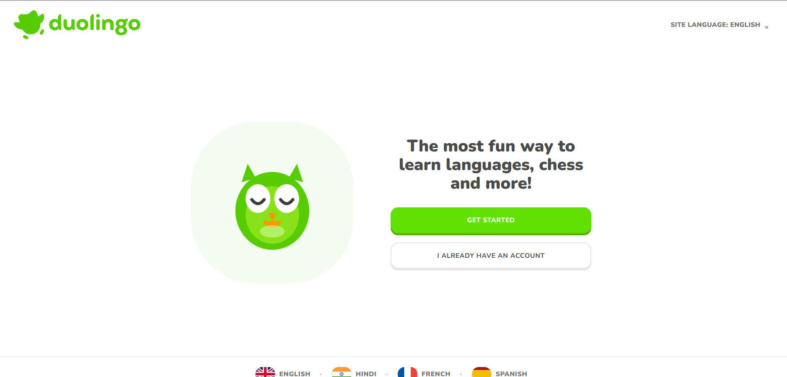
        <br />
        <sub>1. Start page: get started or sign in</sub>
      </td>
      <td align="center">
        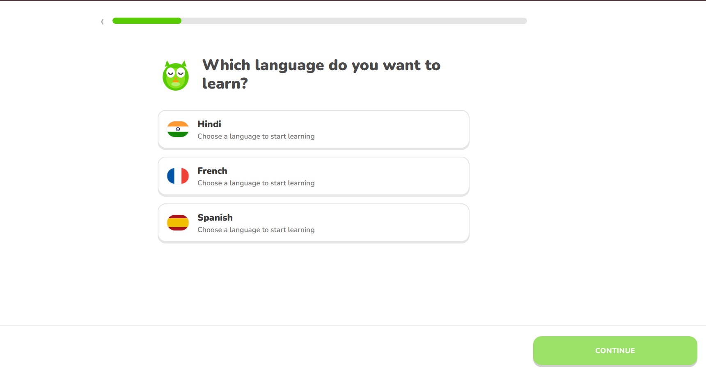
        <br />
        <sub>2. Language to learn</sub>
      </td>
      <td align="center">
        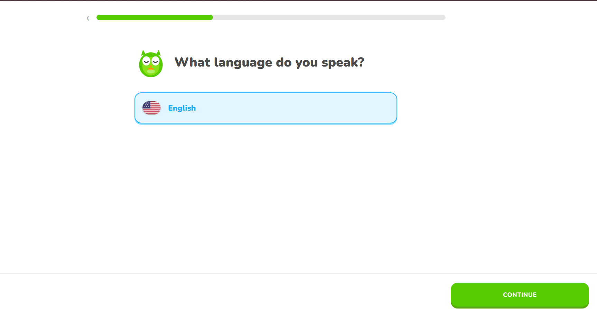
        <br />
        <sub>3. Native language (English)</sub>
      </td>
    </tr>
    <tr>
      <td align="center">
        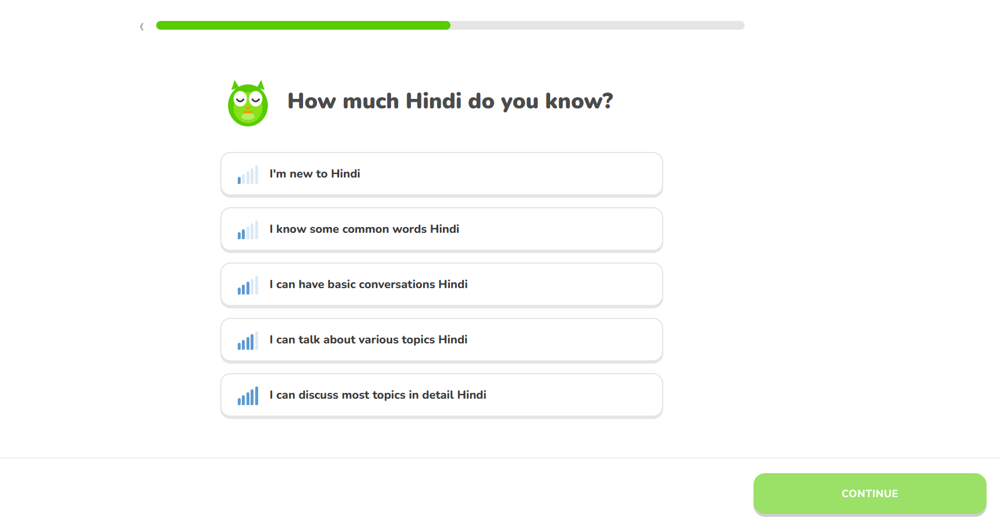
        <br />
        <sub>4. How much of the language you know</sub>
      </td>
      <td align="center">
        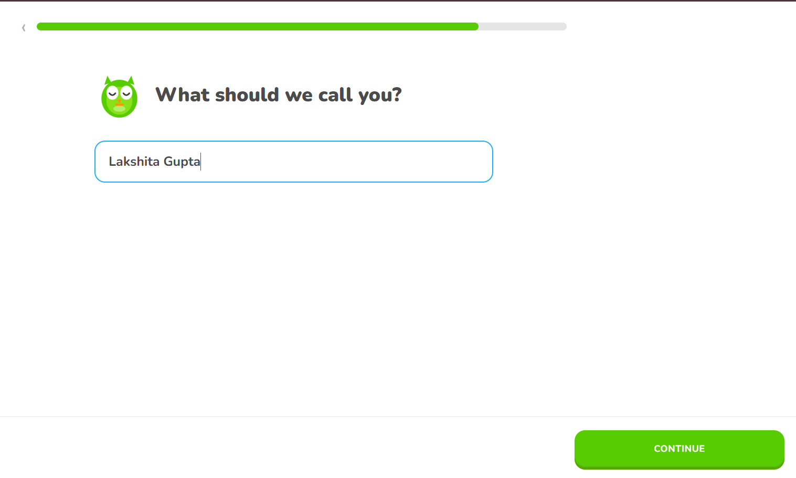
        <br />
        <sub>5. Name</sub>
      </td>
      <td align="center">
        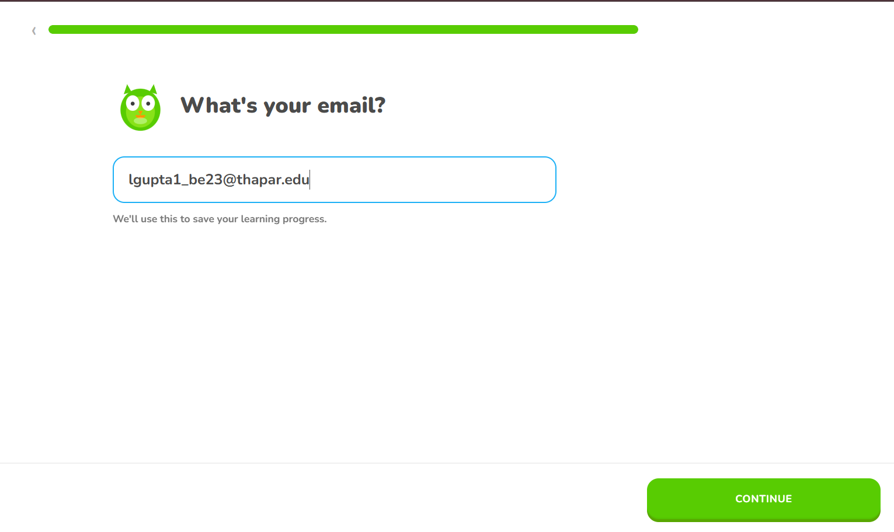
        <br />
        <sub>6. Email, used to find the learner's progress</sub>
      </td>
    </tr>
  </table>
</div>

The flow has six steps: language, native language, proficiency, daily goal (5, 10, 15 or 20 min/day, stored as the daily XP goal), name and email. The daily-goal step is implemented but not pictured above.

### 2. Learning dashboard and course progression

<div align="center">
  <table>
    <tr>
      <td align="center">
        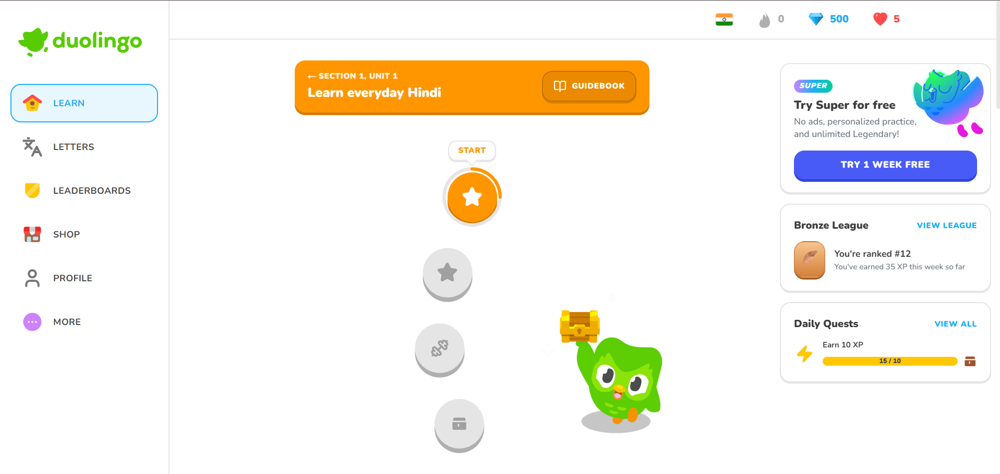
        <br />
        <sub>Section 1, Unit 1: the playable path</sub>
      </td>
      <td align="center">
        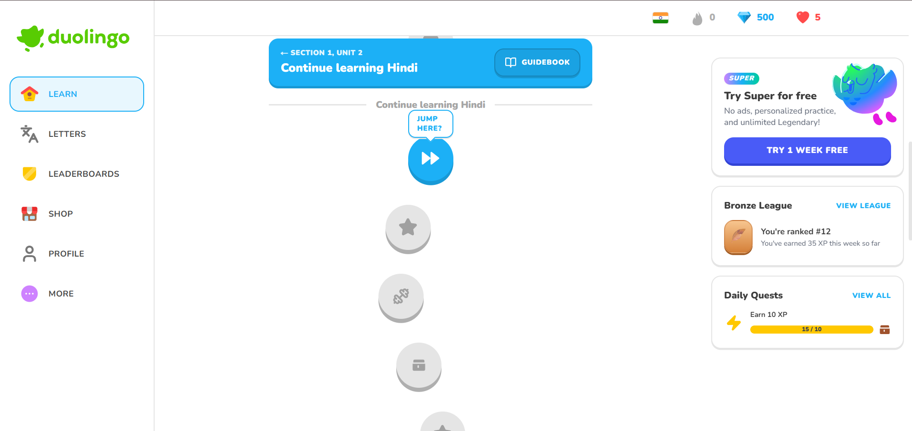
        <br />
        <sub>Section 1, Unit 2: locked placeholder</sub>
      </td>
      <td align="center">
        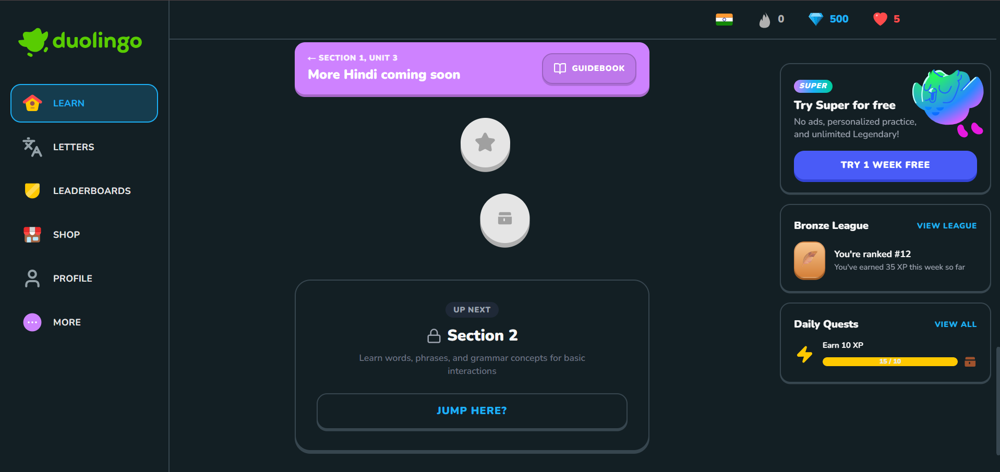
        <br />
        <sub>Unit 3 and the locked Section 2 card (dark mode)</sub>
      </td>
    </tr>
  </table>
</div>

The path shows Section 1 with Units 1, 2 and 3. Only **Unit 1** contains lessons. Each language has two skills (Greetings and Food) and each skill has four levels; levels 1 and 2 are playable and levels 3 and 4 are shown as locked future content. A level unlocks after the previous one is completed, and the second skill unlocks after both playable levels of the first skill are completed. Units 2 and 3 and the Section 2 card are locked placeholders: their "Jump here?" buttons only show a message.

The top bar shows the language flag, streak, gems and hearts. The right rail shows the league card, a daily-quest progress bar based on the learner's daily goal, and a Super promotion card (placeholder).

### 3. Interactive lessons and exercises

<div align="center">
  <table>
    <tr>
      <td align="center">
        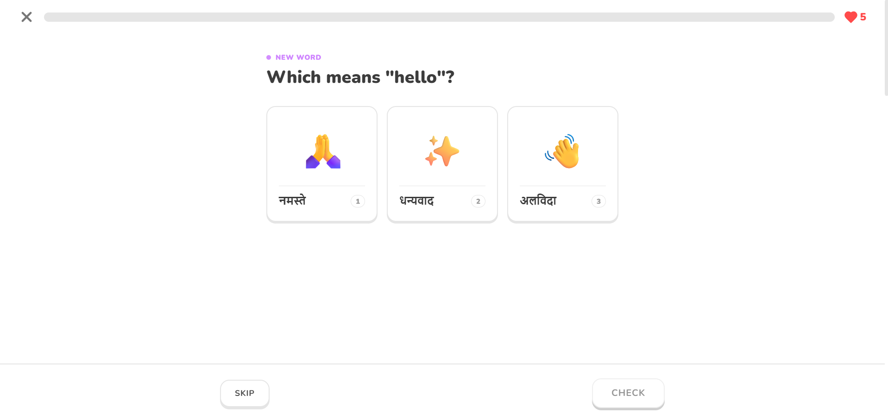
        <br />
        <sub>Multiple choice (Hindi)</sub>
      </td>
      <td align="center">
        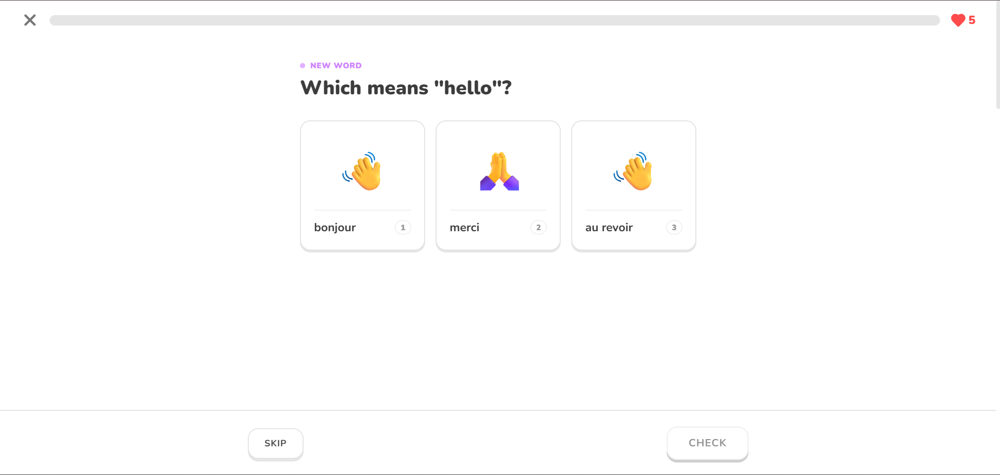
        <br />
        <sub>Multiple choice (French)</sub>
      </td>
      <td align="center">
        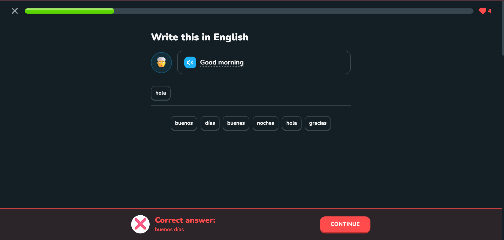
        <br />
        <sub>Word bank with feedback bar (Spanish, dark mode)</sub>
      </td>
    </tr>
  </table>
</div>

Every lesson contains five exercises, one of each type: **multiple choice**, **word-bank translation**, **fill in the blank**, **type the answer** and **match pairs**. The player shows a progress bar, the remaining hearts, and a feedback bar after each check that reveals the correct answer when the learner is wrong. Prompts can be read aloud with the browser's speech synthesis.

### 4. Letters and alphabet learning

<div align="center">
  <table>
    <tr>
      <td align="center">
        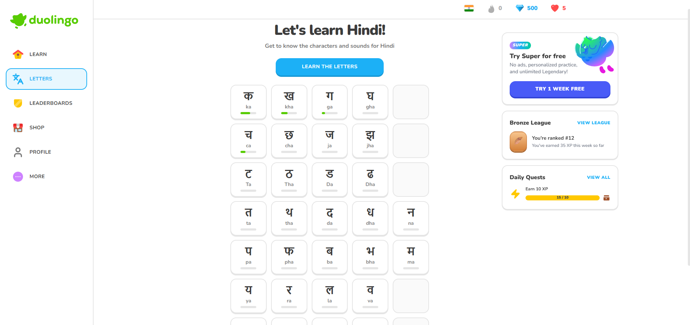
        <br />
        <sub>Hindi: Devanagari with transliteration</sub>
      </td>
      <td align="center">
        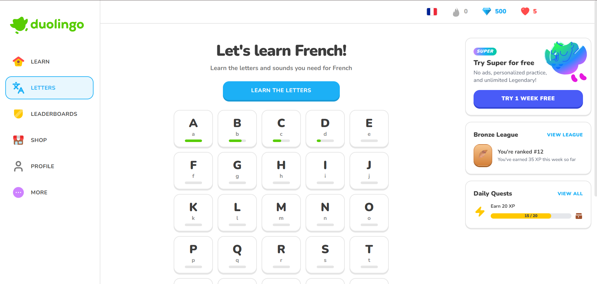
        <br />
        <sub>French alphabet</sub>
      </td>
      <td align="center">
        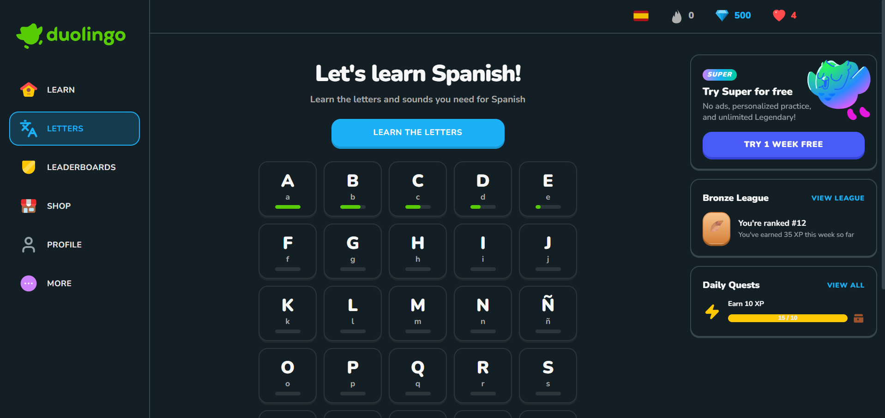
        <br />
        <sub>Spanish alphabet including Ñ (dark mode)</sub>
      </td>
    </tr>
  </table>
</div>

The Letters page follows the learner's selected language. Hindi lists Devanagari characters with their transliteration, French lists the Latin alphabet, and Spanish lists the alphabet including **Ñ**. Tapping a letter or **Learn the letters** speaks it with the browser's speech synthesis. The progress bars under the letters are fixed demo values; they are not tied to the learner's account.

### 5. Leaderboard

<div align="center">
  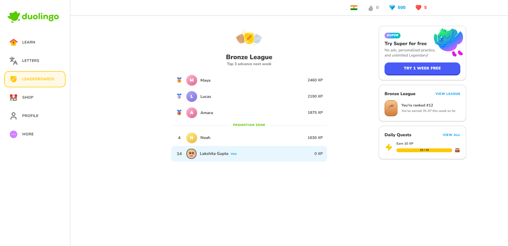
  <br />
  <sub>Bronze League standings with the learner highlighted</sub>
</div>

The leaderboard ranks the learner by total XP against seeded competitors and any other learners stored in the same database. It lists five rows, always including the learner with their true rank, and marks the top three as the promotion zone. It is loaded when the page is opened; it is not a live or global ranking.

### 6. Shop

<div align="center">
  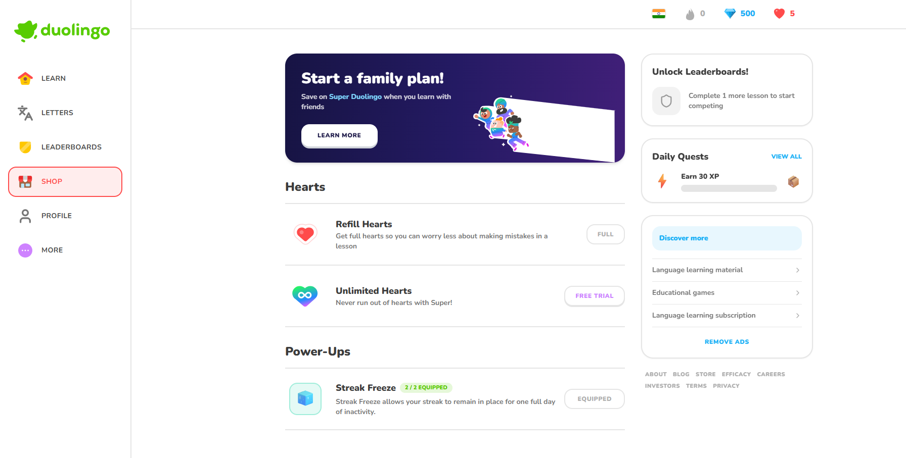
  <br />
  <sub>Shop: hearts and power-ups</sub>
</div>

**Refill Hearts** is the working item: it costs 350 gems, restores all hearts, and is disabled (shown as FULL) when hearts are already full or gems are insufficient. Learners start with 500 gems and earn 5 gems per completed lesson. *Unlimited Hearts*, the family-plan banner and *Streak Freeze* are display-only placeholders.

### 7. Profile and achievements

<div align="center">
  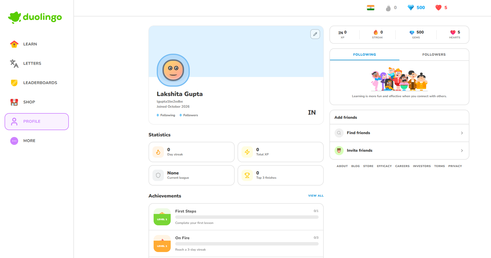
  <br />
  <sub>Profile: avatar, statistics and achievements</sub>
</div>

The profile shows the learner's name, avatar (editable), join date, XP, streak, gems and hearts, and an achievements list with progress from the backend. The league, "Top 3 finishes" and the Following/Followers and friends panels are static placeholders.

### 8. More, settings, help and logout

<div align="center">
  <table>
    <tr>
      <td align="center">
        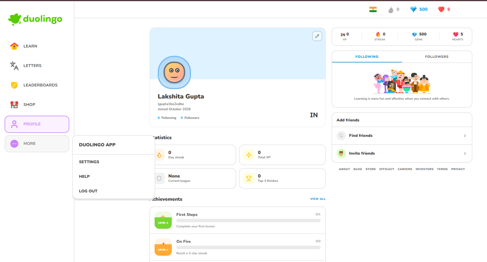
        <br />
        <sub>More menu: Settings, Help, Log out</sub>
      </td>
      <td align="center">
        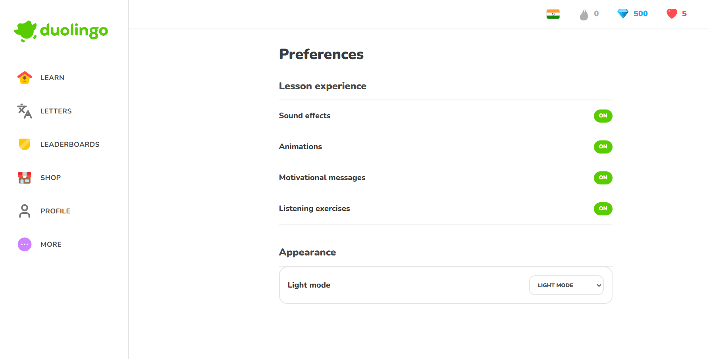
        <br />
        <sub>Settings: Preferences</sub>
      </td>
      <td align="center">
        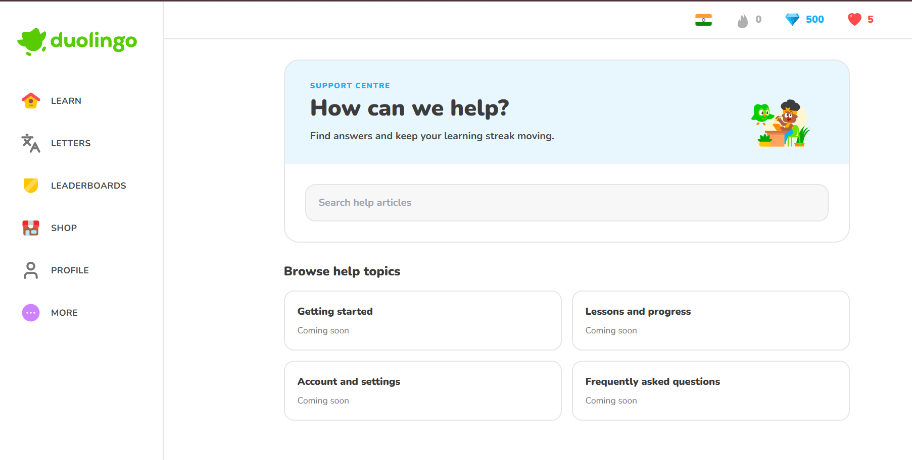
        <br />
        <sub>Help centre (placeholder)</sub>
      </td>
    </tr>
  </table>
</div>

The **More** menu opens Settings, Help or Log out. In Settings the **Light/Dark mode** selector works and is saved to the learner's profile; the lesson-experience rows (sound effects, animations, motivational messages, listening exercises) are display-only. The Help page is a placeholder: the search box and all four topics are "Coming soon". **Log out** clears the saved email from the browser and returns to the start page; the learner's progress stays on the server and is restored by signing in again with the same email.

---

## Key features

**Onboarding and learner setup**
- Six-step onboarding (language, native language, proficiency, daily goal, name, email) and an "I already have an account" sign-in by email.
- Learners are identified by email only; there are no passwords.

**Multilingual learning content**
- Spanish, French and Hindi courses, each with two skills (Greetings, Food) of four levels, five exercises per level (40 exercises per language). The native language is English.
- Course content is stored as JSON files and validated on startup.

**Learning path and progression**
- Skill tree with locked, current and completed states; Section 1 shows Units 1 to 3, of which only Unit 1 is playable.
- The server enforces unlocking: a lesson can only be started when it is unlocked.

**Interactive exercises and answer evaluation**
- Multiple choice, word-bank translation, fill in the blank, typed answer and match pairs.
- Answers are graded on the server. Comparison is case-insensitive, ignores punctuation, and ignores accents on Latin letters only, so Devanagari vowel signs are never stripped.
- Correct answers never reach the browser before the learner has answered.

**XP, hearts, gems, streaks and achievements**
- XP per lesson is `max(5, 15 - 2 x mistakes)`, computed from the server-recorded mistakes.
- Hearts: a maximum of 5, one lost per wrong answer, regenerating one per 30 minutes.
- Gems: 5 per completed lesson; 350 gems refill all hearts.
- Daily streak (resets after a missed day) and a daily XP counter that resets each day.
- Seven achievements: First Steps, On Fire, Wordsmith, Scholar, Sharpshooter, Weekly Warrior, Legendary.

**Practice and legendary lessons**
- Available after a lesson is completed. *Practice* is free of heart loss, awards 5 XP and restores one heart. *Legendary* shuffles the exercises, applies a 60-second per-exercise timer in the interface, costs hearts for wrong answers and awards 40 XP.

**Leaderboard**
- Total-XP ranking against seeded competitors and other learners in the database.

**Letters**
- Language-specific Letters page for Hindi, French and Spanish with spoken pronunciation.

**Shop and profile**
- Heart refill with gems; profile with avatar choice, statistics and achievements.

**Settings, help and logout**
- Theme (light/dark) saved to the learner profile; help centre placeholder; logout.

**Backend validation and persistence**
- Pydantic request validation with readable error messages, versioned SQLite migrations with an automatic backup, and server-side attempts that record every answer.

---

## Technology stack

| Layer | Technology | Responsibility |
|---|---|---|
| Frontend | Next.js 15 (App Router), React 18, TypeScript 5 | Pages (`/` onboarding, `/learn` application) and the `/api/*` proxy rewrite |
| Styling and UI | Tailwind CSS 3, framer-motion, lucide-react, sonner, next-themes | Layout, animation, icons, toasts, light/dark theme |
| Backend | FastAPI 0.115, Uvicorn 0.30 | HTTP API and application lifecycle |
| Validation | Pydantic 2.9, pydantic-settings 2.5 | Request/response schemas (camelCase) and environment settings |
| Data access | SQLAlchemy 2.0 (async), aiosqlite | ORM models and async SQLite access |
| Database | SQLite | Persistent learner data and the synced course catalogue |
| Migrations | Custom runner on `sqlite3` (`PRAGMA user_version`) | Versioned schema upgrades and legacy-data import |
| Tests | pytest, httpx (via FastAPI's `TestClient`) | Backend tests |
| Deployment config | Render blueprint, GitHub Actions workflow | Backend hosting and keep-alive ping |

The frontend `package.json` lists additional dependencies from the project template that the application code does not use.

---

## System architecture

The browser only talks to the Next.js server. Next.js rewrites every `/api/*` request to the FastAPI backend (`BACKEND_API_URL`), so the frontend and backend are separate processes but there is no cross-origin traffic.

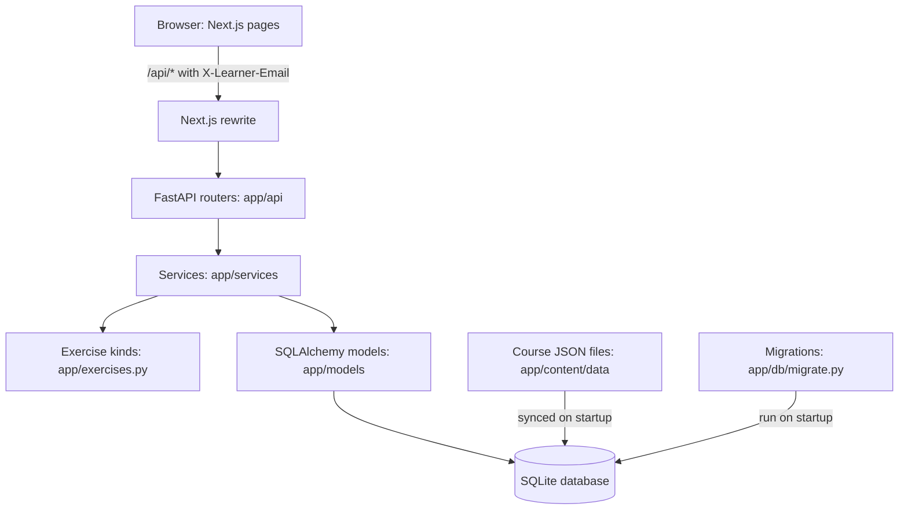

| Area | Role |
|---|---|
| `app/api/` | Thin routers. A dependency resolves the current learner from the `X-Learner-Email` header and applies daily/heart/streak rollover. |
| `app/services/` | Business rules: progression and unlocking, lesson attempts, hearts/streak/XP (`vitals`), achievements, leaderboard, heart refill. |
| `app/exercises.py` | One class per exercise kind with content validation, presentation to the client and grading. |
| `app/schemas/` | Pydantic request/response models. |
| `app/models/` | SQLAlchemy models for the catalogue and for learner state. |
| `app/db/` | Engine and sessions, the migration runner, and the one-time importer for the previous database layout. |
| `app/content/` | Validated JSON course packs plus the idempotent synchroniser that writes them to the database. |

---

## Database design

The schema is created by migration `m001_initial` and mirrored by the SQLAlchemy models. Foreign keys are enforced (`PRAGMA foreign_keys=ON`).

| Table | Purpose |
|---|---|
| `courses` | One row per language (`es`, `fr`, `hi`) |
| `units`, `skills`, `lessons`, `exercises` | Course catalogue. `lessons.playable` marks levels that can be played. `exercises` keeps the client-visible `spec` separate from the `solution`. |
| `learners` | Account profile: email (unique, lowercase), display name, avatar, native language, selected course, proficiency, daily goal, theme |
| `learner_stats` | One row per learner: XP, gems, streak, best streak, last active date, hearts, next heart time, daily XP |
| `lesson_progress` | One row per completed lesson per learner: first/last completion, completion count, best mistakes, last time |
| `lesson_attempts`, `attempt_answers` | One row per lesson run (mode, status, exercise order, mistakes, XP awarded) and one row per answered exercise |
| `achievements`, `learner_achievements` | Achievement catalogue and the unlocked ones per learner |
| `rivals` | Seeded leaderboard competitors |

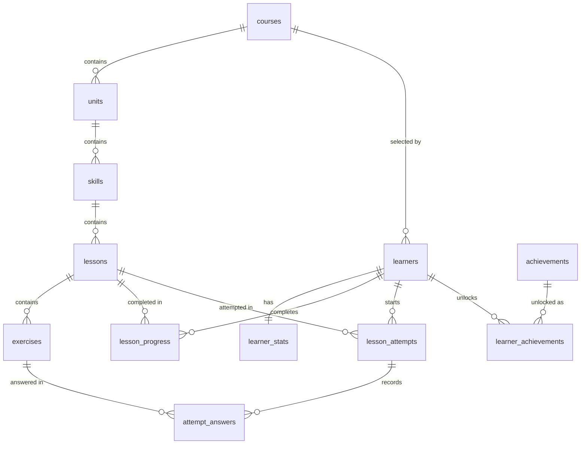

**Static content versus learner data.** The catalogue tables, `achievements` and `rivals` are owned by the code: on every startup `app/content/sync.py` upserts them from `app/content/data/*.json`, so manual edits to those rows are overwritten. Retired lessons that still have learner history are kept. The learner tables (`learners`, `learner_stats`, `lesson_progress`, `lesson_attempts`, `attempt_answers`, `learner_achievements`) are persistent and are never reset by the sync.

**Migrations.** `app/db/migrate.py` reads `PRAGMA user_version` and applies pending migrations inside one transaction. Before upgrading a database that already contains tables it writes a backup next to it (`<name>.pre-v<N>-<timestamp>.bak`; disable with `BACKUP_BEFORE_MIGRATE=false`). When the previous database layout is found, its tables are renamed to `legacy_*` and `app/db/legacy.py` imports learners, completed lessons and achievements into the new tables, mapping old lesson IDs onto the current content, and drops the legacy tables only if every row was mapped. A fresh database is created from scratch by the same runner.

---

## Exercise and progression flow

1. The learner signs in or completes onboarding; the frontend stores the email in the browser and sends it as `X-Learner-Email` on every request.
2. `GET /api/course` returns the learner's course with per-skill and per-lesson `unlocked`, `completed` and `playable` flags.
3. Starting a lesson calls `POST /api/lessons/{id}/attempts` with a mode. The server checks the lock rules and hearts, creates an attempt and returns the exercises without solutions. Match-pair options are shuffled per attempt; legendary attempts also shuffle the exercise order.
4. Each check calls `POST /api/attempts/{id}/answers`. The server grades the answer, records it once per exercise (repeat submissions return the stored result), and returns the correct answer, remaining hearts and the translation if any. A wrong answer in a lesson or legendary attempt costs one heart; when hearts reach zero the attempt fails.
5. After the last exercise, `POST /api/attempts/{id}/complete` validates that every exercise was answered, computes XP, gems, streak, lesson progress and newly unlocked achievements in one transaction, and returns the updated learner. Completing the same attempt again returns the stored result without awarding anything twice. The XP and mistake counts sent by the client, if any, are ignored.

| Mode | Requirement | Hearts | XP | Other effects |
|---|---|---|---|---|
| Lesson | Lesson unlocked; at least one heart | One lost per wrong answer | `max(5, 15 - 2 x mistakes)` | +5 gems, streak, may unlock the next level |
| Practice | Lesson already completed | No loss | 5 | +1 heart, +5 gems |
| Legendary | Lesson already completed; at least one heart | One lost per wrong answer | 40 | Shuffled order, 60 s per exercise in the UI, +5 gems, Legendary achievement |

Unlocking: the first level of a skill is open when the skill is unlocked; each following playable level opens after the previous one is completed; a skill unlocks when the previous skill's playable levels are all completed. Levels 3 and 4 are not playable.

---

## API overview

All routes are served under `/api`. The learner is identified by the `X-Learner-Email` header; when it is absent the default learner (`default-user`) is used. Errors return `{"detail": "...", "code": "..."}`. Interactive documentation is available at `/docs` on the backend.

| Method | Endpoint | Purpose | Notes |
|---|---|---|---|
| POST | `/api/onboarding` | Create a learner, or update the profile of an existing email | Validates email, language (Spanish, French, Hindi) and daily goal (5-60) |
| GET | `/api/user/by-email?email=` | Sign in with an email | `404 learner_not_found` when unknown |
| GET | `/api/user` | Current learner with stats, progress and achievements | Applies daily reset, heart regeneration and streak expiry |
| POST | `/api/user` | Update name, avatar, daily goal or theme | `theme` is `light` or `dark` |
| GET | `/api/course` | Course tree with lock and progress flags | Based on the learner's selected course |
| POST | `/api/lessons/{lesson_id}/attempts` | Start a lesson, practice or legendary attempt | Body `{"mode": "lesson\|practice\|legendary"}`; `403 lesson_locked` / `lesson_not_completed`, `409 out_of_hearts` |
| POST | `/api/attempts/{attempt_id}/answers` | Submit and grade one answer | Body `{"exerciseId", "answer"}`; idempotent per exercise |
| POST | `/api/attempts/{attempt_id}/complete` | Finish an attempt and apply rewards | `409 attempt_incomplete` or `out_of_hearts`; idempotent |
| POST | `/api/hearts/refill` | Refill all hearts with gems | Body `{"method": "gems"}`; costs 350 gems; `400 insufficient_gems` |
| GET | `/api/leaderboard` | Five-row XP standings | Includes the learner's true rank |
| GET | `/api/achievements` | Achievement catalogue with progress and unlocked state | |
| GET | `/api/health` | Health check | Used by hosting and the keep-alive workflow |
| POST | `/api/dev/advance-day` | Simulate the next day | **Development only** (`DEV_TOOLS=true`) |
| POST | `/api/dev/reset` | Reset the current learner's progress | **Development only**; deletes progress. Never expose it publicly |

The `/api/dev/*` routes are mounted only when `DEV_TOOLS` is true. Set `DEV_TOOLS=false` for any shared or public deployment.

---

## Project structure

```text
.
├── README.md
├── render.yaml                    Render blueprint for the backend
├── .github/workflows/keep-alive.yml
├── ScreenShot/                    README screenshots
├── backend/
│   ├── requirements.txt
│   ├── requirements-dev.txt
│   ├── .env.example
│   ├── app/
│   │   ├── main.py                Application factory, CORS, startup
│   │   ├── config.py              Environment settings
│   │   ├── rules.py               XP, hearts, gems and league constants
│   │   ├── exercises.py           Exercise kinds: validation, presentation, grading
│   │   ├── api/                   learners, catalog, lessons, economy, social, dev, deps
│   │   ├── services/              progression, attempts, vitals, achievements, leaderboard, economy, learners
│   │   ├── schemas/               Pydantic request/response models
│   │   ├── models/                catalog.py, learner.py
│   │   ├── core/                  clock, errors, text normalisation
│   │   ├── db/                    session, base, migrate, migrations/m001_initial.py, legacy, bootstrap
│   │   └── content/               packs.py, sync.py, data/ (es, fr, hi, achievements, rivals, courses JSON)
│   └── tests/                     test_api_flow, test_grading, test_migration, test_vitals
└── frontend/
    ├── package.json
    ├── next.config.js             /api/* rewrite to the backend
    ├── tailwind.config.js
    ├── tsconfig.json
    ├── .env.example
    ├── app/
    │   ├── page.tsx               Onboarding / sign-in
    │   ├── learn/page.tsx         Main application shell and API client
    │   ├── layout.tsx, providers.tsx, globals.css
    ├── components/
    │   ├── onboarding/Onboarding.tsx
    │   ├── duo/                   SkillTree, LessonPlayer, LessonComplete, Letters, Leaderboard,
    │   │                          Shop, Profile, Sidebar, TopBar, RightRail, HeartsModal, DuoOwl
    │   └── ui/                    shadcn/ui component files
    └── lib/                       types.ts, language.ts, utils.js, constants/
```

---

## Local setup

**Prerequisites:** Python 3.11 (the Render configuration uses 3.11.9; the pinned `requirements.txt` was verified on 3.11), Node.js 18.18 or newer, and Yarn 1.x (`npm install -g yarn`, or `corepack enable`).

### Backend

Windows (PowerShell):

```powershell
git clone <repository-url>
cd <repository-folder>\backend
py -3.11 -m venv .venv
.\.venv\Scripts\Activate.ps1
pip install -r requirements.txt -r requirements-dev.txt
Copy-Item .env.example .env
uvicorn app.main:app --host 127.0.0.1 --port 8001 --reload
```

macOS / Linux:

```bash
git clone <repository-url>
cd <repository-folder>/backend
python3.11 -m venv .venv
source .venv/bin/activate
pip install -r requirements.txt -r requirements-dev.txt
cp .env.example .env
uvicorn app.main:app --host 127.0.0.1 --port 8001 --reload
```

Run the command from the `backend` folder so that `app.main:app` and the relative `./duolingo.db` path resolve. Check `http://127.0.0.1:8001/api/health`.

On startup the backend runs pending migrations, synchronises the course content and creates the SQLite file `backend/duolingo.db` if it does not exist. An existing database is upgraded in place after an automatic backup. No manual seeding step is needed.

### Frontend

In a second terminal:

```powershell
cd <repository-folder>\frontend
yarn install
$env:BACKEND_API_URL = "http://127.0.0.1:8001"
yarn dev
```

macOS / Linux:

```bash
cd <repository-folder>/frontend
yarn install
BACKEND_API_URL=http://127.0.0.1:8001 yarn dev
```

Open `http://localhost:3000` (the `dev` script uses port 3000; `BACKEND_API_URL` already defaults to `http://127.0.0.1:8001`). If port 3000 is busy, run `npx next dev --port 3100` instead.

---

## Environment variables

**Backend** (`backend/.env`, see `backend/.env.example`)

| Variable | Default in code | Purpose |
|---|---|---|
| `DATABASE_URL` | `sqlite+aiosqlite:///./duolingo.db` | SQLite location; only SQLite URLs are supported |
| `CORS_ORIGINS` | `*` | Comma-separated allowed origins (the browser normally calls the frontend origin through the proxy) |
| `TIMEZONE` | empty (server local time) | IANA zone, for example `Asia/Kolkata`, used for streak and daily-goal day boundaries |
| `DEV_TOOLS` | `false` on Render | Controls the development-only `/api/dev/*` routes |
| `BACKUP_BEFORE_MIGRATE` | `true` | Write a `.bak` copy before migrating an existing database |

**Frontend** (`frontend/.env.example`)

| Variable | Default | Purpose |
|---|---|---|
| `BACKEND_API_URL` | `http://127.0.0.1:8001` | Target of the `/api/*` rewrite. Read when Next.js starts or builds, so set it before `yarn build` when deploying |

Deployment-only settings: `PYTHON_VERSION` (set in `render.yaml`) and the GitHub Actions repository variable `BACKEND_URL` used by the keep-alive workflow. Real `.env` files are git-ignored.

---

## Testing and verification

**Automated backend tests** (from `backend/` with the virtual environment active):

```bash
pytest
```

The backend test suite covers API flows, grading and content validation, migration and legacy-data import, and heart, streak and daily-XP logic.

**Frontend checks** (from `frontend/`):

```bash
npx tsc --noEmit    # type-check
yarn build          # production build
```

There is no lint script. The type-check was clean during development.

**Manual verification checklist** (in a browser):

- [ ] Onboard with each of Spanish, French and Hindi, then log out and sign in again with the same email.
- [ ] Complete level 1, confirm level 2 unlocks, complete it, confirm the Food skill unlocks.
- [ ] Answer correctly and incorrectly in each of the five exercise types; hearts drop only on wrong answers.
- [ ] Finish a lesson: XP, gems and streak increase, and achievements unlock (First Steps, Sharpshooter).
- [ ] Practice a completed level (+1 heart) and try a legendary run.
- [ ] Lose all hearts, then refill them in the Shop with 350 gems.
- [ ] Open Letters for each language, the Leaderboard, Profile (change avatar), and Settings (switch to dark mode).

---

## Deployment

[The application is deployed here](https://duolingo-web-app-delta.vercel.app/). The deployment options are:

- **Vercel (frontend) + Render (backend).** `render.yaml` defines the backend web service and `.github/workflows/keep-alive.yml` pings `/api/health` every five minutes to limit cold starts. On Vercel set the root directory to `frontend` and `BACKEND_API_URL` to the Render URL before building.
- **A single VPS** running both processes under systemd with a reverse proxy.

**Data persistence limitation.** The FastAPI backend currently uses SQLite on Render's free service. The backend's SQLite database file is stored on the service filesystem, and persistent disk storage is not configured, so data should not be assumed to survive every restart, redeployment or filesystem replacement. If the database file is lost or reset, learner history and progress stored in it—including lesson progress, XP, streaks, hearts and other learner-specific data—may be lost. A persistent disk or a suitable managed database would improve long-term data reliability; the keep-alive workflow does not guarantee database persistence.

---

## Known limitations and future improvements

- Authentication is email-only: anyone who knows an email can open that account.
- Only two skills per language exist, and only levels 1 and 2 of each skill are playable. Units 2 and 3, Section 2 and the Guidebook are placeholders.
- The native language is fixed to English.
- Placeholder or static UI: the Help topics, the lesson-experience toggles in Settings, Super and family-plan offers, Unlimited Hearts, Streak Freeze, friends/followers, Profile league and "Top 3 finishes", the right-rail "ranked #12" text, and the progress bars on the Letters page. The right rail also falls back to demo values (for example 15 XP) when a learner's value is zero.
- The leaderboard is all-time XP against seeded competitors and other local learners; the league is always "Bronze" and there is no weekly reset or promotion.
- The legendary 60-second timer runs in the browser; the server does not enforce it.
- Speech uses the browser's speech-synthesis voices, which vary by browser and operating system.
- SQLite limits the backend to a single instance. There is no lint configuration.

---

## Assignment and project notes

- Built entirely by **Lakshita Gupta** (Roll Number: **102303505**), a student of **Thapar**, following the guidelines given by **Scaler**.
- This is a Duolingo-inspired educational application. Duolingo's name, mascot and visual style are used for educational demonstration only; there is no affiliation.
- Course content (phrases and vocabulary) is limited demonstration material.

---

## Conclusion

The application delivers a complete small learning product: onboarding, three languages, a locked learning path, five exercise types graded on the server, XP, hearts, gems, streaks, achievements, practice and legendary runs, a leaderboard, language-specific letters, a shop, a profile and settings. SQLite persistence with versioned migrations supports learner data across schema upgrades when the database file is retained, and the documented deployment options explain what is required to host it.
